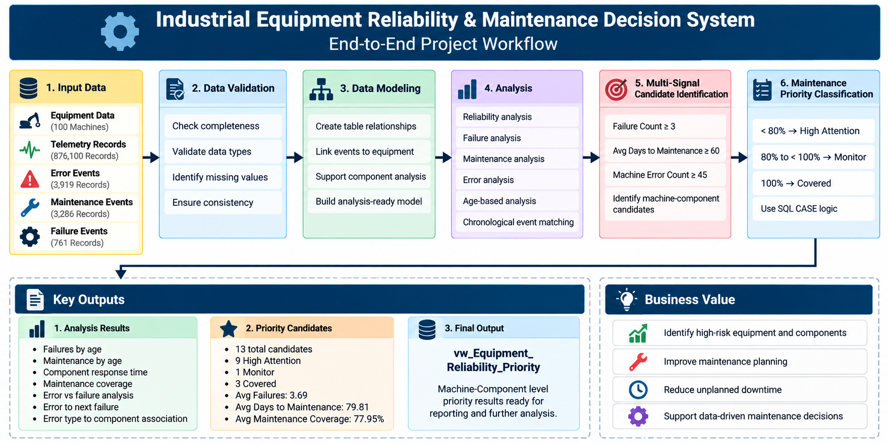
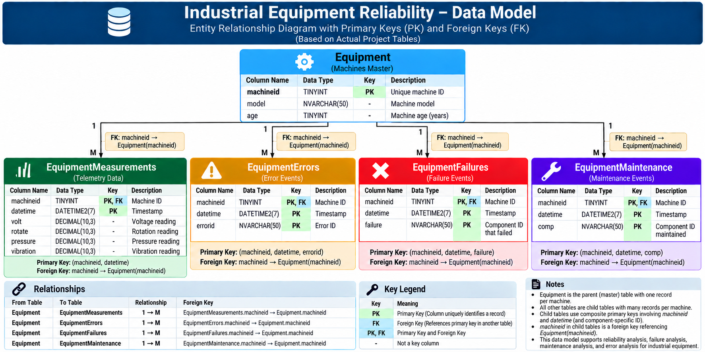

# Industrial Equipment Reliability & Maintenance Decision System

## Project Overview

This project is an SQL-based industrial equipment reliability and maintenance decision system built using the **Microsoft Azure Predictive Maintenance (PdM) synthetic dataset**.

The objective is to analyze equipment failures, errors, maintenance events, equipment age, and failure-to-maintenance response time, then convert these records into transparent maintenance-priority information.

The project focuses on **Microsoft SQL Server and analytical SQL logic** rather than building only a reporting dashboard.

> **Important:** The dataset is synthetic and does not represent real-world equipment or production data.

---

## Business Objective

The system addresses practical reliability and maintenance questions such as:

- Which equipment records the most failures?
- Which components fail most frequently?
- How does equipment age relate to recorded failures?
- How frequently are maintenance events recorded?
- How long after a failure is the next matching maintenance event recorded?
- Which equipment/components have repeated failures?
- Which failures have no later matching maintenance record in the available dataset?
- Do higher error frequencies coincide with higher failure frequencies?
- Which equipment/component combinations satisfy multiple reliability-warning signals?
- Which priority candidates have lower recorded maintenance coverage?

The final output is a **rule-based maintenance priority view** that combines multiple signals into one decision-oriented dataset.

---

## Dataset

The project uses the Microsoft Azure Predictive Maintenance synthetic dataset.

### Source Data

| Source Table | Description | Records |
|---|---|---:|
| `PdM_machines` | Machine master data | 100 |
| `PdM_telemetry` | Machine telemetry measurements | 876,100 |
| `PdM_errors` | Machine error events | 3,919 |
| `PdM_maint` | Maintenance events | 3,286 |
| `PdM_failures` | Machine failure events | 761 |

### Data Characteristics

| Dataset | Date Range |
|---|---|
| Telemetry | 2015-01-01 to 2016-01-01 |
| Errors | 2015-01-01 to 2016-01-01 |
| Maintenance | 2014-06-01 to 2016-01-01 |
| Failures | 2015-01-02 to 2015-12-31 |

---

## Core Data Model

After validating the source data, the project was structured into five core tables.

| Core Table | Purpose | Records |
|---|---|---:|
| `Equipment` | Equipment master information | 100 |
| `EquipmentMeasurements` | Equipment telemetry measurements | 876,100 |
| `EquipmentErrors` | Equipment error events | 3,919 |
| `EquipmentMaintenance` | Equipment maintenance events | 3,286 |
| `EquipmentFailures` | Equipment failure events | 761 |

### Primary Keys and Foreign Keys

| Table | Primary Key | Foreign Key |
|---|---|---|
| `Equipment` | `machineID` | — |
| `EquipmentMeasurements` | `(machineID, datetime)` | `machineID → Equipment(machineID)` |
| `EquipmentErrors` | `(machineID, datetime, errorID)` | `machineID → Equipment(machineID)` |
| `EquipmentMaintenance` | `(machineID, datetime, comp)` | `machineID → Equipment(machineID)` |
| `EquipmentFailures` | `(machineID, datetime, failure)` | `machineID → Equipment(machineID)` |

All child/event tables have a **many-to-one relationship back to `Equipment` through `machineID`**.

---

## Project Workflow

The analytical workflow is:

    Raw PdM Data
         |
         v
    Source/Core Data Validation
         |
         v
    Equipment & Event Tables
         |
         v
    Reliability Analysis
         |
         +-----------------------------+
         |                             |
         v                             v
    Failure Analysis            Maintenance Analysis
         |                             |
         +-------------+---------------+
                       |
                       v
          Failure-to-Maintenance Response
                       |
                       v
              Maintenance Coverage
                       |
                       v
              Error-to-Failure Analysis
                       |
                       v
            Multi-Signal Decision Rules
                       |
                       v
           Maintenance Priority View
                       |
                       v
            Validation & Final Summary

---

## Project Architecture

### Project Workflow

---

### Data Model

---

# Analytical Modules

## 1. Data Validation

The project first validates the structure and quality of the analytical data.

Validation includes:

- Row-count reconciliation between source and core tables
- Primary-key uniqueness
- Foreign-key/orphan checks
- NULL checks
- Date-range validation
- Telemetry-value checks
- Business-rule validation
- Priority-classification validation

---

## 2. Equipment Reliability Analysis

The reliability analysis calculates equipment-level and component-level metrics including:

- Failure counts
- Error counts
- Maintenance counts
- Failure frequency by equipment age
- Maintenance frequency by equipment age
- Failure-to-maintenance response time
- Repeated component failures
- Equipment with prolonged maintenance response

The analysis uses aggregated event summaries before joining event tables to avoid **many-to-many event multiplication**.

---

## 3. Failure-to-Maintenance Analysis

For each recorded failure, the system identifies the **next chronological maintenance event for the same machine and component** where applicable.

The analysis calculates:

- Failure date
- Next matching maintenance date
- Days between failure and maintenance
- Maintenance coverage
- Equipment/component combinations with repeated failures
- Recorded failures without a later matching maintenance event

> **Important:** A later maintenance record is treated as a chronological proxy. It does not prove that the maintenance event repaired that exact failure.

---

## 4. Error-to-Failure Analysis

The project analyzes temporal relationships between error events and subsequent failures.

Examples include:

- Error frequency versus failure frequency
- Error-frequency groups versus average time to next failure
- Error type to component failure associations

These results are used as analytical signals rather than causal conclusions.

> **Important:** Temporal association does not establish that an error caused a failure.

---

# Maintenance Decision Engine

The final decision engine combines multiple reliability signals.

A machine/component combination becomes a priority candidate when all three project-defined conditions are satisfied:

    failure_count >= 3
    avg_days_to_maintenance >= 60
    error_count >= 45

These thresholds are **project-defined analytical rules**, not industry standards.

---

## Maintenance Priority Classification

Maintenance coverage is classified as:

    < 80%        → High Attention
    80% to <100% → Monitor
    100%         → Covered

The resulting view is:

`vw_Equipment_Reliability_Priority`

It provides a consolidated equipment/component-level decision dataset containing:

- Machine ID
- Model
- Equipment age
- Component
- Failure count
- Average days to maintenance
- Error count
- Maintenance coverage percentage
- Maintenance priority

---

# Final Decision Engine Results

The final validated priority view contains:

| Metric | Result |
|---|---:|
| Total priority candidates | 13 |
| High Attention | 9 |
| Monitor | 1 |
| Covered | 3 |
| Average failures per candidate | 3.69 |
| Average days to maintenance | 79.81 days |
| Average maintenance coverage | 77.95% |

These results describe the synthetic dataset and the project-defined rules only.

---

# Validation Results

The final validation script checks:

### 1. Machine + Component Uniqueness

Expected result:

    0 duplicate rows

### 2. Business Rule Validation

Every row in the final priority view satisfies:

    failure_count >= 3
    avg_days_to_maintenance >= 60
    error_count >= 45

Expected result:

    0 rule violations

### 3. Priority Classification Validation

The maintenance coverage classification is verified against:

    < 80%        → High Attention
    80% to <100% → Monitor
    100%         → Covered

Expected result:

    0 classification violations

### 4. NULL Validation

Required analytical fields are checked for NULL values.

Expected result:

    0 NULL violations

### 5. Final Priority Summary

Expected result:

    Total Candidates = 13
    High Attention   = 9
    Monitor          = 1
    Covered          = 3

---

# SQL Concepts Demonstrated

The project demonstrates practical Microsoft SQL Server techniques including:

- `SELECT`
- `WHERE`
- `GROUP BY`
- `HAVING`
- `ORDER BY`
- `INNER JOIN`
- `LEFT JOIN`
- `OUTER APPLY`
- `TOP 1`
- `COUNT`
- `COUNT(DISTINCT)`
- `SUM`
- `AVG`
- `ISNULL`
- `CASE`
- `DATEDIFF`
- Common Table Expressions
- Derived tables
- Aggregate-before-join strategy
- Decimal calculations
- SQL Views
- Primary-key and foreign-key validation
- Business-rule implementation
- Analytical validation

---

# Key SQL Design Lessons

## Avoiding Many-to-Many Event Multiplication

Directly joining multiple event tables only by `machineID` can multiply event records and produce incorrect counts.

The project therefore uses:

    Event Table
        ↓
    Aggregate by Equipment / Component
        ↓
    Join Aggregated Results

This keeps reliability metrics analytically consistent.

---

## LEFT JOIN for Zero-Event Equipment

The project uses `Equipment` as the master table and `LEFT JOIN`s aggregated event summaries so that machines with zero recorded events are not unintentionally removed.

---

## Failure-Level Maintenance Matching

Maintenance coverage is evaluated at the failure level using:

    same machine
    +
    same component
    +
    maintenance timestamp > failure timestamp

This is more precise than checking whether a machine has any maintenance record anywhere in the dataset.

---

# Important Data Interpretation Notes

This project intentionally avoids unsupported operational claims.

### Synthetic Dataset

The dataset is synthetic and should not be interpreted as actual operational data from any real-world organization.

### Failure → Maintenance

The analysis identifies the next recorded maintenance event after a failure. It does not prove that the maintenance event repaired that exact failure.

### Maintenance Coverage

Coverage means that a later matching maintenance record exists within the available dataset period. It does not prove repair completion.

### Dataset Boundary

A failure near the end of the dataset may have no later maintenance record simply because the available data ends before a subsequent event occurs.

### Error → Failure

The error analysis identifies temporal associations between error events and subsequent failures. It does not establish causality.

### Priority Classification

`High Attention`, `Monitor`, and `Covered` are project-defined decision categories based on explicit thresholds. They are not industry-standard risk classifications.

### Rule-Based Decision Engine

The final decision engine is a transparent SQL rule system, not a machine-learning prediction model.

---

# Project Structure

    Industrial-Equipment-Reliability-SQL/
    |
    +-- Readme.md
    |
    +-- SQL/
    |   +-- 30 SQL analysis and validation scripts
    |
    +-- Data/
    |   +-- readme.md
    |
    +-- Documentation/
    |   +-- Business_Questions.md
    |   +-- Data_Dictionary.md
    |
    +-- Images/
        +-- data_model.png
        +-- project_workflow.png

---

# Documentation

Additional project documentation:

- `Data/readme.md` — dataset and source-data documentation
- `Documentation/Business_Questions.md` — business questions and analytical requirements
- `Documentation/Data_Dictionary.md` — core table and column definitions
- `Images/data_model.png` — validated relational data model
- `Images/project_workflow.png` — end-to-end analytical workflow

---

# Project Outcome

The project transforms raw predictive-maintenance event data into a structured SQL-based equipment reliability analysis system.

The final output is a **maintenance decision-support dataset** rather than simply a collection of SQL queries.

It demonstrates how industrial event data can be:

    Validated
       ↓
    Modeled
       ↓
    Aggregated
       ↓
    Analyzed
       ↓
    Connected Across Events
       ↓
    Converted Into Business Rules
       ↓
    Validated
       ↓
    Presented as Maintenance Priorities

---

# Skills Demonstrated

## SQL & Data

- Microsoft SQL Server
- Relational data modeling
- Primary and foreign keys
- Event-data analysis
- Data validation
- Aggregation
- CTEs
- Complex joins
- `OUTER APPLY`
- SQL Views
- Business-rule implementation

## Industrial Analytics

- Equipment reliability
- Predictive maintenance concepts
- Failure analysis
- Maintenance response analysis
- Component-level analysis
- Maintenance coverage analysis
- Reliability decision logic

## Analytical Thinking

- Translating business questions into SQL
- Avoiding many-to-many event multiplication
- Designing transparent business rules
- Distinguishing association from causation
- Validating analytical outputs
- Building decision-oriented SQL analysis

---

# Author

**R. Purushothamansai**

Data / SQL | Industrial Analytics | Predictive Maintenance

This project was developed as a portfolio project to demonstrate the application of SQL analytics to industrial equipment reliability and maintenance data.